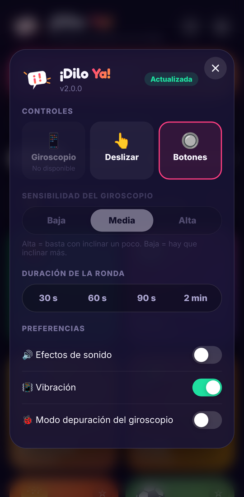
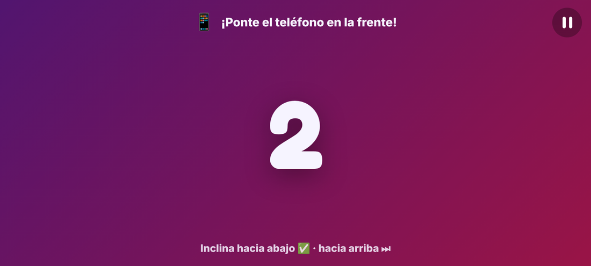

<p align="center">
  <picture>
    <source media="(prefers-color-scheme: dark)" srcset=".github/readme/banner-dark.svg">
    <source media="(prefers-color-scheme: light)" srcset=".github/readme/banner-light.svg">
    
  </picture>
</p>

<p align="center">
  <a href="https://github.com/matsukiender-star/SayItAlready/releases/latest"><b>Descargar</b></a> &nbsp;·&nbsp;
  <a href="https://github.com/matsukiender-star/SayItAlready/wiki"><b>Wiki</b></a> &nbsp;·&nbsp;
  <a href="https://github.com/matsukiender-star/SayItAlready/wiki/Como-jugar"><b>Cómo jugar</b></a> &nbsp;·&nbsp;
  <a href="https://github.com/matsukiender-star/SayItAlready/issues/new/choose"><b>Pedir un cambio</b></a>
</p>

---

¡Dilo Ya! es un juego de fiesta para adivinar palabras. Elige un mazo y ponte el teléfono en la frente con la pantalla hacia tus amigos. Ellos te dan pistas sin decir la palabra: **inclinas hacia abajo si adivinaste y hacia arriba para pasar**. Gana quien acierte más antes de que se acabe el tiempo.

> [!NOTE]
> Funciona sin internet, sin cuentas, sin anuncios y sin rastreo. Todo se queda en tu teléfono. Es un fork en español de [Say It Already!](https://github.com/david-risney/SayItAlready) de David Risney.

<p align="center">
  
  
  
  
</p>
<p align="center">
  
  
</p>

## Funciones

- **26 mazos en español:** más de 1,600 palabras en tres dificultades, de películas y series a dichos de la abuela. La lista completa está en [Mazos](#mazos).
- **Giroscopio afinado:** se calibra solo con tu postura al terminar la cuenta 3-2-1, tiene sensibilidad baja, media o alta, y no cuenta dos veces el mismo gesto.
- **Otros controles:** deslizar en la pantalla, tocar botones o usar el teclado (Espacio, Enter y Esc). Si el teléfono no tiene giroscopio, cambia solo a botones.
- **Dificultad que se adapta:** si pasas una palabra, la siguiente es más fácil; si aciertas dos seguidas, sube el reto.
- **Animaciones:** tarjetas 3D, cuenta regresiva, destellos y partículas en cada acierto, y confeti en el resumen.
- **Tus propios mazos:** créalos con ícono, colores y dificultad por palabra, y compártelos con un código QR o en JSON.
- **Hecha para la frente:** pantalla completa, horizontal, siempre encendida y con vibración en cada acierto.

## Mazos

| Categoría | Mazos |
| --- | --- |
| 🧩 Clásicos | Animales · Objetos de la casa · Comida · Profesiones · Países y ciudades · Deportes · Instrumentos musicales · Transportes · Partes del cuerpo |
| 🎬 Entretenimiento | Películas · Pelis animadas · Series y novelas · Superhéroes y villanos · Caricaturas · Anime · Sagas épicas · Videojuegos · Pokémon · Personajes Nintendo |
| 🔥 Cultura pop | Famosos · Música y cantantes · Comida rápida y marcas · Memes e internet · Dichos y refranes · Los años 2000 |
| 🎭 Mímica | Acciones para actuar sin hablar |

Cada mazo trae ejemplos en la wiki: [Mazos](https://github.com/matsukiender-star/SayItAlready/wiki/Mazos).

## Descargar

Para Android 7.0 o superior. Descarga el archivo `DiloYa-vX.Y.Z.apk` de la [última versión](https://github.com/matsukiender-star/SayItAlready/releases/latest). Cada versión trae también un archivo `.sha256` para comprobar que la descarga está completa.

También hay una versión web que se instala desde el navegador en cualquier teléfono. Necesita activarse una vez en GitHub Pages; los pasos están en [Publicar versiones](https://github.com/matsukiender-star/SayItAlready/wiki/Publicar-versiones).

## Instalar

¡Dilo Ya! no se vende en tiendas de apps, por eso Android pide un permiso extra la primera vez.

### Android

1. Descarga el `.apk` en tu teléfono desde la [última versión](https://github.com/matsukiender-star/SayItAlready/releases/latest).
2. Ábrelo. Android pide permitir la instalación de apps desde tu navegador o tu administrador de archivos. Permítelo esta vez.
3. Pulsa **Instalar** y abre **¡Dilo Ya!**.

Si Play Protect avisa que la app es desconocida, pulsa **Más detalles** y luego **Instalar de todas formas**. El aviso aparece porque la app no viene de Google Play.

### Versión web

1. Abre la página de la versión web en Chrome.
2. Pulsa el menú ⋮ y luego **Agregar a la pantalla principal** o **Instalar app**.

### Actualizar

| Dónde | Cómo |
| --- | --- |
| Android | Descarga el `.apk` nuevo e instálalo encima. Tus mazos, favoritos y ajustes se conservan. |
| Web | Abre **⚙️ Ajustes**. Si hay versión nueva aparece **actualizar**; púlsalo. |

Más detalles y solución de problemas en [Instalación](https://github.com/matsukiender-star/SayItAlready/wiki/Instalacion).

## Cómo jugar

1. Elige un mazo, o pulsa **¡Sorpréndeme!** para uno al azar.
2. Escoge la dificultad y pulsa **¡Jugar!**.
3. Ponte el teléfono en la frente, en horizontal, con la pantalla hacia tus amigos.
4. Ellos describen, actúan o cantan la palabra sin decirla.
5. **Inclina hacia abajo** ✅ si adivinaste o **hacia arriba** ⏭ para pasar.
6. Al acabarse el tiempo verás tus aciertos y la lista de palabras.

## Guías

| Guía | De qué trata |
| --- | --- |
| [Cómo jugar](https://github.com/matsukiender-star/SayItAlready/wiki/Como-jugar) | Reglas, variantes para grupos y dificultad adaptativa |
| [Controles y giroscopio](https://github.com/matsukiender-star/SayItAlready/wiki/Controles-y-giroscopio) | Calibración, sensibilidad, deslizar, botones y teclado |
| [Ajustes](https://github.com/matsukiender-star/SayItAlready/wiki/Ajustes) | Cada opción de ⚙️ Ajustes |
| [Crear y compartir mazos](https://github.com/matsukiender-star/SayItAlready/wiki/Crear-y-compartir-mazos) | Editor, formato JSON y códigos QR |
| [Preguntas frecuentes](https://github.com/matsukiender-star/SayItAlready/wiki/Preguntas-frecuentes) | Problemas comunes y cómo resolverlos |
| [Desarrollo](https://github.com/matsukiender-star/SayItAlready/wiki/Desarrollo) | Compilar, probar y agregar mazos al código |
| [Arquitectura](https://github.com/matsukiender-star/SayItAlready/wiki/Arquitectura) | Cómo está organizado el código |
| [Publicar versiones](https://github.com/matsukiender-star/SayItAlready/wiki/Publicar-versiones) | Release del APK, firma y versión web |

Las páginas de la wiki salen de la carpeta [`docs/wiki`](docs/wiki), así que también se pueden leer desde el código.

## Compilar

Necesitas Node.js 22. Para compilar el APK también necesitas JDK 21 y el Android SDK, o puedes dejar que lo compile GitHub Actions.

```bash
npm install
npm test                 # pruebas, validación de mazos y límite de 800 líneas por archivo
npm run build:web        # copia la web a www/
npx serve www            # pruébala en http://localhost:3000
npm run android:sync     # pasa www/ al proyecto Android
cd android && ./gradlew assembleDebug   # APK de depuración
```

Cada cambio en GitHub corre las pruebas y compila un APK de depuración. Cada tag `v*` publica un Release con el APK firmado.

## Contribuir

¿Encontraste un error o quieres un mazo nuevo? [Abre un issue](https://github.com/matsukiender-star/SayItAlready/issues/new/choose): hay plantillas para errores, ideas y mazos. Antes de mandar código, lee la [guía para contribuir](CONTRIBUTING.md). Para reportar un problema de seguridad, lee la [política de seguridad](SECURITY.md).

## Privacidad

Todo se queda en tu dispositivo. La app no tiene analíticas, rastreo ni publicidad. El giroscopio solo se lee durante la partida y sus datos no se guardan. Más detalles en [PRIVACY.md](PRIVACY.md).

## Licencia

¡Dilo Ya! es software libre con [licencia MIT](LICENSE), basado en [Say It Already!](https://github.com/david-risney/SayItAlready) de David Risney. Las tipografías Fredoka e Inter usan la licencia SIL Open Font License.
