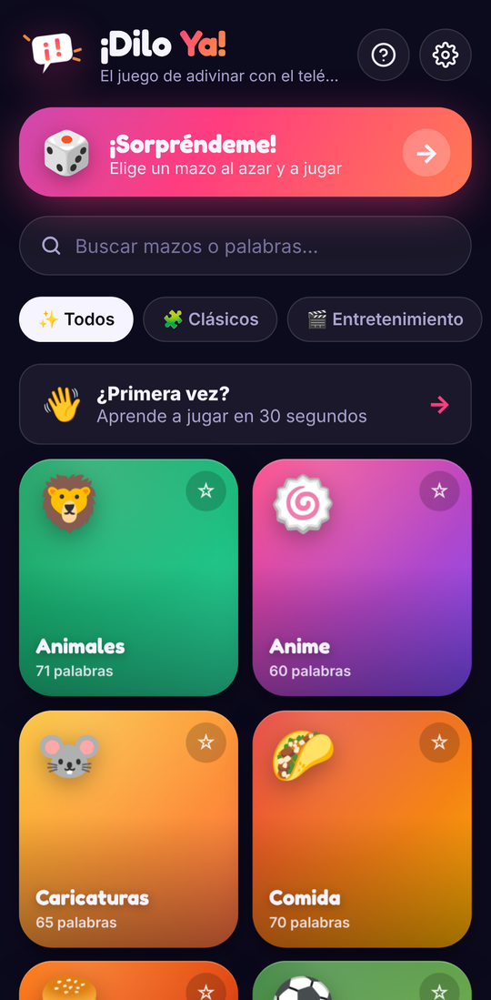
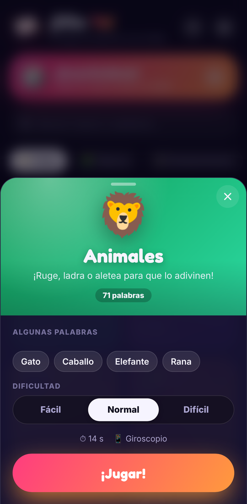
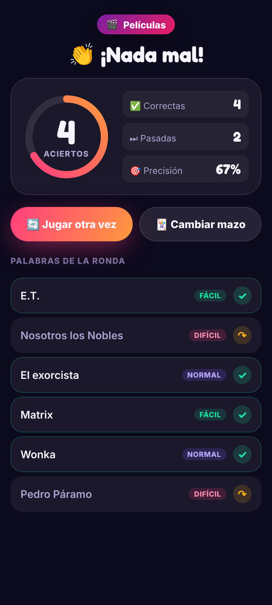
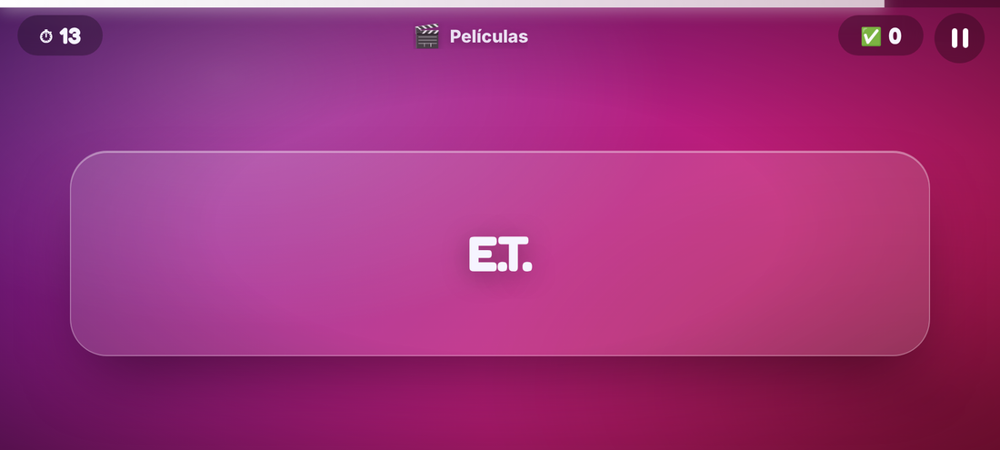

# ¡Dilo Ya! 📱

El juego de adivinar palabras con el teléfono en la frente. Elige un mazo, ponte el celular en la frente y deja que tus amigos te den pistas. **Inclina hacia abajo si adivinaste y hacia arriba para pasar.**

App de **Android** (APK) y versión web instalable, toda en español.

<p align="center">
  
  &nbsp;
  
  &nbsp;
  
</p>
<p align="center">
  
</p>

## Descargar

Descarga el APK más reciente desde **[Releases](../../releases/latest)** y ábrelo en tu teléfono. Si Android lo pide, permite «Instalar apps desconocidas». Requiere Android 7.0 o superior.

## Qué trae

- **26 mazos en español** con más de 1,600 palabras en tres dificultades:
  - **Clásicos:** Animales, Objetos de la casa, Comida, Profesiones, Países y ciudades, Deportes, Instrumentos, Transportes, Partes del cuerpo
  - **Entretenimiento:** Películas, Pelis animadas, Series y novelas, Superhéroes, Caricaturas, Anime, Sagas épicas, Videojuegos, Pokémon, Personajes Nintendo
  - **Cultura pop:** Famosos, Música y cantantes, Marcas, Memes e internet, Dichos y refranes, Los años 2000
  - **Mímica:** acciones para actuar sin hablar
- **Giroscopio afinado:** se calibra solo con tu postura al terminar la cuenta 3‑2‑1, tiene sensibilidad ajustable (baja/media/alta) y no cuenta dos veces el mismo gesto.
- También se juega **deslizando**, con **botones** en pantalla o con el **teclado** (Espacio = acierto, Enter = pasar, Esc = pausa).
- Interfaz nueva con animaciones: tarjetas 3D, cuenta regresiva, destellos de acierto y pase, partículas, confeti y resumen con puntuación animada.
- Dificultad adaptativa: si pasas una palabra, la siguiente es más fácil; si aciertas dos seguidas, sube el reto.
- Crea tus propios mazos y compártelos con código QR o JSON.
- Funciona sin internet. Sin cuentas, sin anuncios y sin rastreo.

## Cómo jugar

1. Elige un mazo (o toca **¡Sorpréndeme!**).
2. Ponte el teléfono en la frente con la pantalla hacia tus amigos.
3. Ellos describen la palabra sin decirla: pueden actuar, cantar o hacer sonidos.
4. **Inclina hacia abajo** si adivinaste ✅ o **hacia arriba** para pasar ⏭.
5. Al acabarse el tiempo verás cuántas acertaste.

## Desarrollo

Es una app web sin frameworks (HTML, CSS y JavaScript con módulos ES y Web Components) empaquetada para Android con [Capacitor](https://capacitorjs.com/).

```sh
npm install
npm test               # pruebas del giroscopio + validación de mazos
npm run build:web      # copia la web a www/
npx serve www          # pruébala en el navegador
npm run android:sync   # copia www/ al proyecto Android
npm run android:open   # abre Android Studio
```

| Carpeta | Qué hay |
| --- | --- |
| `js/components/` | Pantallas: inicio, juego y resumen |
| `js/services/` | Giroscopio, sonidos, reloj, almacenamiento y capa nativa (`native.js`) |
| `packs/` | Mazos en JSON (generados desde `scripts/decks-src/`) |
| `android/` | Proyecto Android de Capacitor |
| `.github/workflows/` | CI, release del APK y publicación web |

### Agregar o editar mazos

Edita `scripts/decks-src/decks-*.mjs` y ejecuta:

```sh
npm run build:packs && npm run validate
```

### Publicar una versión

1. Sube la versión en `package.json`, `js/version.js`, `sw.js` y `android/app/build.gradle` (`versionCode` y `versionName`).
2. Crea y sube un tag: `git tag v2.0.1 && git push origin v2.0.1`.
3. GitHub Actions compila el APK firmado y lo publica en Releases.

La firma usa un keystore de desarrollo incluido en el repo. Para Google Play, configura tu propio keystore: lee [android/keystore/README.md](android/keystore/README.md).

### Versión web

El workflow **Web · GitHub Pages** publica la versión web. Actívalo en *Settings → Pages → Source: GitHub Actions* y luego ejecútalo desde la pestaña *Actions*.

## Créditos y licencia

Fork de [Say It Already!](https://github.com/david-risney/SayItAlready) de David Risney, rediseñado y traducido al español. Licencia [MIT](LICENSE). Tipografías Fredoka e Inter con licencia SIL OFL.

Privacidad: todo se queda en tu teléfono. Lee [PRIVACY.md](PRIVACY.md).
