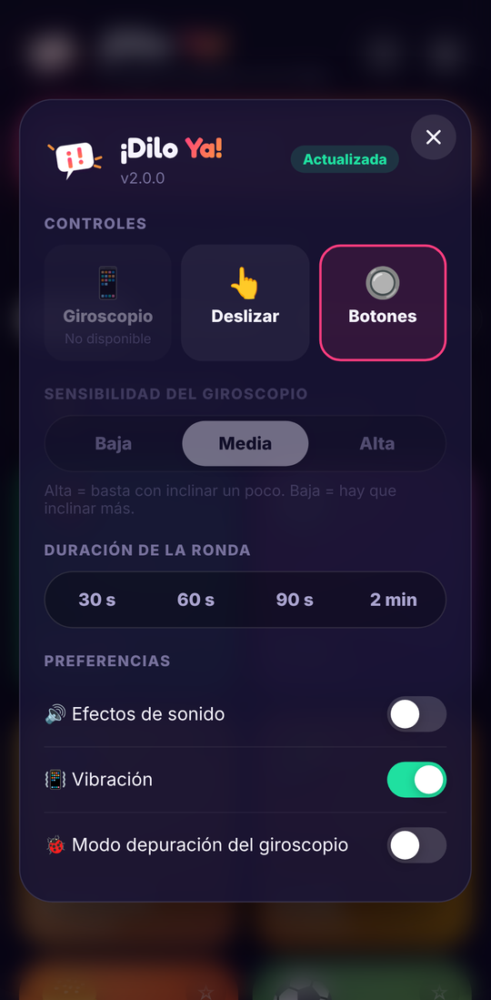

# Ajustes

Se abren con el engrane ⚙️ arriba a la derecha de la pantalla de inicio. Los cambios se guardan al instante en el dispositivo.

  

| Opción | Valores | Por defecto | Qué hace |
| --- | --- | --- | --- |
| Controles | Giroscopio, Deslizar, Botones | Giroscopio | Cómo respondes en la partida. Ver [Controles y giroscopio](Controles-y-giroscopio). |
| Sensibilidad del giroscopio | Baja, Media, Alta | Media | Cuánto hay que inclinar. Se atenúa si no usas el giroscopio. |
| Duración de la ronda | 30 s, 60 s, 90 s, 2 min | 60 s | Tiempo de cada ronda. |
| Efectos de sonido | Sí / No | Sí | Tonos de acierto, pase, cuenta regresiva y fin. |
| Vibración | Sí / No | Sí | Vibración en cada acierto, pase y aviso. |
| Modo depuración del giroscopio | Sí / No | No | Muestra los datos del sensor durante la partida. |

## Estado de la app

Arriba del diálogo se ven la versión y unas etiquetas:

- **Actualizada** o **vX.Y.Z — actualizar** (solo en la versión web).
- **Instalada** o **Instalar app** (solo en la versión web; en Android siempre dice Instalada).

## Opciones no disponibles

- **Deslizar** aparece como *No disponible* en dispositivos sin pantalla táctil.
- **Giroscopio** aparece como *No disponible* si el dispositivo no tiene sensor o no dio permiso.

En los dos casos, si estaba elegido, la app cambia a **Botones**.

## Dónde se guardan

Los ajustes van en `localStorage` con la clave `diloya-settings`. El código está en `js/services/storage/settings.js`.
